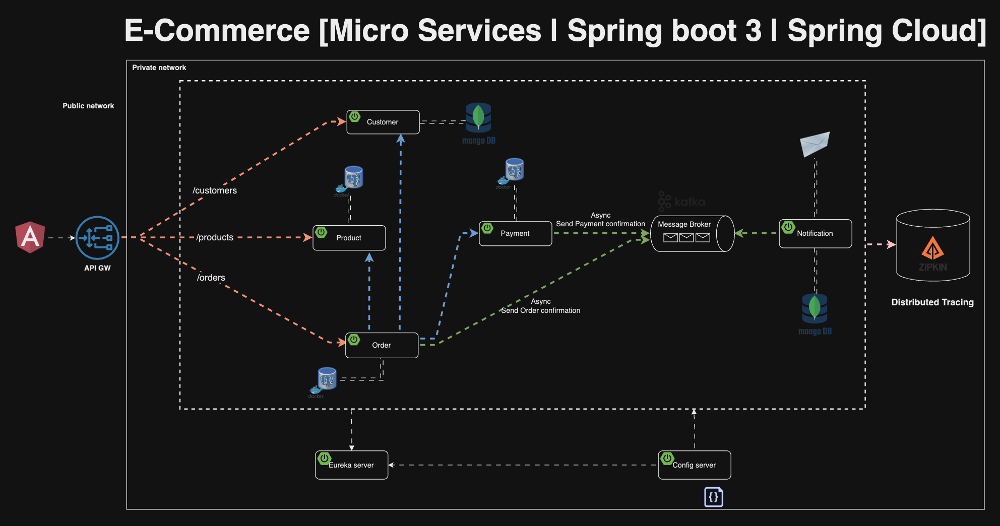
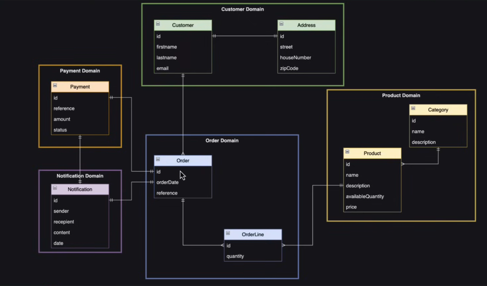

# E-commerce Microservices (Spring Boot)

Dự án mô phỏng hệ thống e-commerce theo kiến trúc microservices, tập trung vào việc áp dụng các nguyên tắc **system design** trong thực tế: phân tách domain, giao tiếp đồng bộ/bất đồng bộ, cấu hình tập trung, service discovery và API gateway.

Mục tiêu chính của repository này là đóng vai trò như một tài liệu tham khảo kỹ thuật cho việc thiết kế và triển khai hệ thống phân tán bằng Spring Boot/Spring Cloud.

## 1) Giới thiệu

Hệ thống được tách theo từng domain nghiệp vụ độc lập:

- Quản lý khách hàng
- Quản lý sản phẩm và tồn kho
- Quản lý đơn hàng
- Thanh toán
- Gửi thông báo

Các service giao tiếp theo 2 hướng:

- **REST (đồng bộ)**: cho các thao tác cần phản hồi ngay.
- **Kafka (bất đồng bộ)**: cho event nghiệp vụ, giảm coupling giữa các service.

## 2) Mục tiêu dự án

- Xây dựng một kiến trúc microservice rõ ràng, dễ mở rộng.
- Minh hoạ cách tổ chức hệ thống theo domain-driven boundaries.
- Áp dụng pattern phổ biến trong hệ phân tán:
	- Centralized Configuration (`config-server`)
	- Service Discovery (`discovery` - Eureka)
	- API Gateway (`gateway`)
	- Event-Driven Communication (Kafka)
- Làm nền tảng học tập/phỏng vấn/thực hành system design cho bài toán e-commerce.

## 3) Tổng quan hệ thống

Các thành phần chính:

- `config-server`: Quản lý cấu hình tập trung cho toàn bộ services.
- `discovery`: Eureka Server để đăng ký và tìm kiếm service.
- `gateway`: Điểm vào duy nhất từ client, định tuyến request vào service nội bộ.
- `customer`: Quản lý thông tin khách hàng (MongoDB).
- `product`: Quản lý catalog sản phẩm, tồn kho (PostgreSQL + Flyway).
- `order`: Xử lý tạo đơn, điều phối luồng nghiệp vụ đặt hàng.
- `payment`: Xử lý nghiệp vụ thanh toán.
- `notification`: Nhận event từ Kafka, gửi email và lưu lịch sử thông báo.

## 4) Thiết kế kiến trúc (System Design)

### 4.1 Kiến trúc microservices theo domain

Mỗi service sở hữu một phạm vi nghiệp vụ riêng, giảm phụ thuộc trực tiếp và hỗ trợ scale độc lập theo tải của từng domain.

### 4.2 API Gateway Pattern

`gateway` đóng vai trò entry point cho client:

- Ẩn topology nội bộ của hệ thống.
- Tập trung routing.
- Thuận tiện để mở rộng thêm auth/rate limit/logging ở một điểm chung.

### 4.3 Service Discovery Pattern

`discovery` (Eureka) giúp các service tự đăng ký và tìm thấy nhau động, tránh hardcode địa chỉ service.

### 4.4 Centralized Configuration Pattern

`config-server` cung cấp cấu hình tập trung cho các service, hỗ trợ thay đổi cấu hình nhất quán theo môi trường.

### 4.5 Event-Driven Architecture

Kafka được dùng cho luồng bất đồng bộ:

- `order` và `payment` phát sinh event nghiệp vụ.
- `notification` consume event để gửi email/lưu lịch sử.

Lợi ích:

- Giảm coupling giữa producer/consumer.
- Tăng khả năng mở rộng theo chiều ngang.
- Dễ tích hợp thêm consumer mới trong tương lai.

## 5) Luồng nghiệp vụ chính

Kịch bản tạo đơn hàng (rút gọn):

1. Client gọi API tạo đơn qua `gateway`.
2. `order` kiểm tra dữ liệu khách hàng và sản phẩm.
3. `order` cập nhật tồn kho và tạo đơn.
4. `order` gọi `payment` để xử lý thanh toán.
5. `order`/`payment` phát event lên Kafka.
6. `notification` nhận event, gửi email xác nhận và lưu thông tin thông báo.

## 6) Sơ đồ kiến trúc

### 6.1 System Architecture



### 6.2 Domain Diagram



## 7) Công nghệ sử dụng

- Java 17
- Spring Boot 3
- Spring Cloud (Config Server, Eureka, Gateway, OpenFeign)
- PostgreSQL (order, payment, product)
- MongoDB (customer, notification)
- Apache Kafka + Zookeeper
- Flyway (DB migration cho product service)
- MailDev (test email local)
- Docker Compose

## 8) Hạ tầng local

File `docker-compose.yml` cung cấp các thành phần phục vụ chạy local:

- PostgreSQL + pgAdmin
- MongoDB + mongo-express
- Kafka + Zookeeper
- MailDev

## 9) Cách chạy dự án (tham khảo)

Thứ tự khuyến nghị:

1. Khởi động hạ tầng bằng Docker Compose.
2. Chạy `config-server`.
3. Chạy `discovery`.
4. Chạy lần lượt các business services (`customer`, `product`, `order`, `payment`, `notification`).
5. Chạy `gateway` và bắt đầu gọi API từ phía client.

> Gợi ý: Có thể dùng Maven Wrapper (`./mvnw spring-boot:run`) trong từng service.

### Build và test với parent Maven chung

Root `pom.xml` quản lý Java 17, Spring Boot 3.3.3 và Spring Cloud BOM 2023.0.3
cho cả 8 service và các thư viện support. `services/pom.xml` quản lý 8 service;
`support/pom.xml` quản lý `common-module`. Các dependency riêng và cấu hình đóng
gói vẫn nằm trong POM của từng module.

Từ thư mục gốc, dùng Maven Wrapper hiện có để build và test toàn bộ reactor:

```bash
./services/order/mvnw -f pom.xml --batch-mode verify
```

Chỉ build và test một service cùng các module cần thiết:

```bash
./services/order/mvnw -f pom.xml -pl services/product -am --batch-mode verify
```

Vẫn có thể chạy `./mvnw test` hoặc `./mvnw spring-boot:run` bên trong từng service;
parent trung gian được đọc qua `../pom.xml`, rồi kế thừa root parent;
không cần cài parent trước.

### Pagination cho API danh sách

`GET /api/v1/customers`, `/api/v1/products`, `/api/v1/orders` và
`/api/v1/payments` đều phân trang ở database, sắp xếp theo `id` tăng dần:

```http
GET /api/v1/products?page=0&size=20
```

- `page`: bắt đầu từ `0`, mặc định `0`.
- `size`: từ `1` đến `100`, mặc định `20`.
- Tham số không hợp lệ trả `400 application/problem+json`, có lỗi theo field.
- Trang vượt quá dữ liệu trả `200` với `content: []`.

Response danh sách đổi từ mảng trực tiếp sang object có metadata:

```json
{
  "content": [],
  "page": 0,
  "size": 20,
  "totalElements": 0,
  "totalPages": 0,
  "first": true,
  "last": true
}
```

Client đọc danh sách qua `content` và tăng `page` để lấy trang tiếp theo cho đến
khi `last` là `true`. Các API lấy một bản ghi hoặc mua sản phẩm không đổi contract.

### Error response: Problem Details

Các API customer, product, order, payment và lỗi do gateway phát sinh dùng
`application/problem+json` với `type`, `title`, `status`, `detail`, `instance`.
Sử dụng `ProblemDetail` của Spring (RFC 7807, được thay thế bởi RFC 9457).
Client cần đọc `detail` thay vì coi response lỗi là chuỗi; validation giữ thêm
map `errors` theo tên field:

```json
{
  "type": "about:blank",
  "title": "Bad Request",
  "status": 400,
  "detail": "Request validation failed",
  "instance": "/api/v1/products/purchase",
  "errors": {
    "products[0].quantity": "Quantity is mandatory"
  }
}
```

- Validation/JSON không hợp lệ và lỗi nghiệp vụ: `400`.
- Thiếu/sai Bearer token tại gateway: `401`, giữ header `WWW-Authenticate`.
- Không có quyền: `403`; không tìm thấy resource: `404`.
- HTTP method không hỗ trợ: `405`, giữ header `Allow`.
- Gateway không tìm được service instance: `503`.
- Lỗi bất ngờ: `500`, không trả stack trace hoặc chi tiết exception nội bộ.

## 10) Giá trị học thuật về System Design

Dự án phù hợp để học và thảo luận các chủ đề:

- Bounded Context và ranh giới domain trong microservices.
- Trade-off giữa giao tiếp đồng bộ (REST) và bất đồng bộ (event).
- Tính nhất quán dữ liệu trong hệ phân tán.
- Khả năng chịu lỗi, retry, idempotency (có thể mở rộng thêm).
- Quan sát hệ thống (logging/metrics/tracing) cho production-ready architecture.

## 11) Hạn chế hiện tại và hướng mở rộng

Hạn chế hiện tại:

- Dự án thiên về mục tiêu học kiến trúc, chưa tối ưu cho production.
- Một số cấu hình đang thiên về môi trường local.

Hướng mở rộng đề xuất:

- Bổ sung test coverage (unit/integration/contract).
- Bổ sung bảo mật (OAuth2/JWT, secret management, TLS).
- Thêm resilience patterns (circuit breaker, retry, timeout, DLQ).
- Bổ sung observability (OpenTelemetry, Prometheus, Grafana).
- Chuẩn hoá CI/CD và chiến lược deploy đa môi trường.

## 12) Đối tượng phù hợp

- Người mới bắt đầu với Spring Microservices.
- Backend engineer muốn thực hành system design qua bài toán e-commerce.
- Sinh viên/người tự học cần một dự án end-to-end để phân tích kiến trúc.

## 13) Đối chiếu với JD Backend Data Platform

> Đánh giá này chỉ phản ánh những gì đang có trong repository, không thể chứng minh
> kinh nghiệm vận hành thực tế hoặc yêu cầu “2+ years”. Các mục được đánh dấu “một
> phần” cần có test, benchmark hoặc tài liệu vận hành để biến thành bằng chứng khi
> phỏng vấn.

### Trạng thái

- [x] **Đã có**: Có implementation hoặc cấu hình có thể kiểm tra trong repository.
- [~] **Một phần / cần hoàn thiện**: Có nền tảng nhưng chưa đủ production-ready hoặc
  chưa có bằng chứng kiểm thử/vận hành.
- [ ] **Chưa có**: Chưa tìm thấy implementation trong repository.
- [!] **Issue / rủi ro**: Có điểm cần sửa trước khi dùng như một production example.

### Những phần project đã làm được

- [x] **Microservice architecture**: tách domain thành `customer`, `product`, `order`,
  `payment`, `notification`; có `config-server`, Eureka `discovery` và API `gateway`.
- [x] **Giao tiếp đồng bộ và bất đồng bộ**: order dùng OpenFeign/REST cho các dependency
  cần phản hồi ngay; order/payment publish event và notification consume bằng Kafka.
- [x] **Java/Spring backend**: Java 17, Spring Boot 3, Spring Cloud, validation, JPA,
  transaction boundary và Flyway migration cho product.
- [x] **Modern data stores**: PostgreSQL cho các domain giao dịch và MongoDB cho
  customer/notification; có persistence layer tương ứng.
- [x] **Streaming technology**: Kafka producer/consumer, topic cho order/payment và
  MailDev để kiểm thử luồng gửi email local.
- [~] **Một phần fault tolerance ở tầng database**: PostgreSQL HA local với Patroni,
  etcd, HAProxy, PgBouncer, read/write split và hướng dẫn failover tại
  [`pg-replication/README.md`](pg-replication/README.md).
- [~] **Load balancing nền tảng**: Eureka và route `lb://...` trong gateway; dependency
  `spring-cloud-starter-loadbalancer` đã được bật. Cần smoke test các route `lb://`
  và cập nhật hướng dẫn chạy, xem backlog bên dưới.
- [~] **Security và observability nền tảng**: gateway có OAuth2 resource server/JWT,
  các service có Actuator/Micrometer tracing, Zipkin được khai báo trong Docker Compose.
- [~] **Asynchronous programming**: `@Async` cho email và Kafka listener đã có; tuy
  nhiên chưa có thiết kế hoặc benchmark rõ ràng cho concurrency/parallel processing.
- [~] **Vận hành local**: Docker Compose cung cấp PostgreSQL, MongoDB, Kafka/Zookeeper,
  Zipkin, Keycloak và MailDev; có hướng dẫn khởi động theo thứ tự.

### Checklist theo yêu cầu JD

#### Core engineering và distributed systems

- [x] Thiết kế, build feature trong kiến trúc microservices.
- [~] Hệ thống phân tán có nhiều dependency và transaction giữa service.
- [~] Fault tolerance và high availability: PostgreSQL đã có failover; business
  service chưa có circuit breaker, retry, timeout policy, bulkhead hoặc DLQ.
- [ ] Chứng minh hệ thống chịu tải lớn: chưa có load test, benchmark, capacity planning,
  SLO/SLI hoặc kết quả throughput/latency.
- [~] Java fundamentals, collections và stream API được sử dụng; chưa có module/test
  thể hiện data structures và algorithms một cách rõ ràng.
- [~] Async/concurrent programming có `@Async` và Kafka; chưa có worker pool,
  backpressure, concurrency control hoặc test race condition.

#### Data platform và data stores

- [x] PostgreSQL và MongoDB đã được tích hợp vào các service.
- [x] Kafka đã được dùng cho event-driven processing.
- [ ] Redis cache/distributed lock/rate limit.
- [ ] Elasticsearch hoặc search/indexing pipeline.
- [ ] Offline/batch processing, data lake/warehouse hoặc ETL.
- [ ] Sharding/partitioning ở application/database level.
- [~] Replication MongoDB: chưa có; PostgreSQL replication mới được mô phỏng local.

#### Testing, operation và reliability

- [~] Có test context-load cho từng service.
- [ ] Unit test cho business logic và repository.
- [ ] Integration test với PostgreSQL/MongoDB/Kafka thật (ví dụ Testcontainers).
- [ ] Contract test cho Feign/API và event schema compatibility.
- [ ] Backup/restore đã được tự động hoá và có quy trình kiểm chứng RPO/RTO.
- [~] Health check/tracing có nền tảng; chưa có Prometheus/Grafana dashboard,
  centralized logs, alerting, on-call runbook hoặc incident drill.
- [ ] CI/CD, deployment đa môi trường và rollback strategy.

#### Internal web tools và security

- [~] Keycloak/OAuth2 JWT mới được cấu hình ở gateway; chưa có flow provisioning,
  phân quyền theo role/scope và test security đầy đủ.
- [ ] ReactJS hoặc frontend cho internal web tools vận hành financial products.
- [!] Docker Compose đang dùng credential local hard-code (`12345`); không được dùng
  cấu hình này ngoài local. Cần secret manager, TLS và rotate credentials.

### Backlog ưu tiên để nâng mức đáp ứng JD

Các mục dưới đây là **chưa triển khai/đang làm theo nghĩa backlog**, không phải cam kết
đã hoàn thành:

- [ ] **P0 - Kiểm chứng gateway load balancing**: dependency
  `spring-cloud-starter-loadbalancer` đã được bật; chạy smoke test các route `lb://`
  và cập nhật hướng dẫn chạy.
- [ ] **P0 - Reliability cho event và REST**: thêm timeout, retry có giới hạn,
  circuit breaker, idempotency key, DLQ và replay procedure.
- [ ] **P0 - Test thực chất**: thêm unit test business rule, integration test bằng
  Testcontainers và Kafka event contract test.
- [ ] **P1 - Observability vận hành**: expose metrics chuẩn, dựng Prometheus/Grafana,
  centralized logging, alert rule và dashboard cho latency/error/consumer lag.
- [ ] **P1 - Data scale**: thêm Redis với cache invalidation, benchmark trước/sau;
  đánh giá partitioning/sharding theo access pattern thay vì chỉ thêm database.
- [ ] **P1 - Data safety**: MongoDB replica set, PostgreSQL/MongoDB backup-restore
  automation và kiểm thử RPO/RTO.
- [ ] **P1 - Security hardening**: loại credential khỏi compose, secrets management,
  TLS, RBAC/scope và security integration tests.
- [ ] **P2 - Internal operations UI**: xây ReactJS tool cho tra cứu/vận hành payment,
  có audit log và role-based access control.
- [ ] **P2 - Production delivery**: CI/CD, deployment staging, load test, capacity
  report và runbook cho deploy/rollback/failover.

## 14) PostgreSQL Replication Architecture

Hệ thống replication PostgreSQL được triển khai tại thư mục [`pg-replication/`](pg-replication/):

- **1 Primary** (write) + **2 Replicas** (read) quản lý bởi **Patroni**
- **etcd** làm Distributed Configuration Store cho leader election
- **HAProxy** phân tách read/write traffic và load-balance reads
- **PgBouncer** cho connection pooling
- Automatic failover không cần can thiệp thủ công
- Application không cần thay đổi connection string sau failover

```
App writes  →  PgBouncer (:6432)  →  HAProxy (:5000)  →  Primary
App reads   →  HAProxy (:5001)    →  Replica 1 / Replica 2 (round-robin)
```

Xem [`pg-replication/README.md`](pg-replication/README.md) để biết hướng dẫn đầy đủ.


