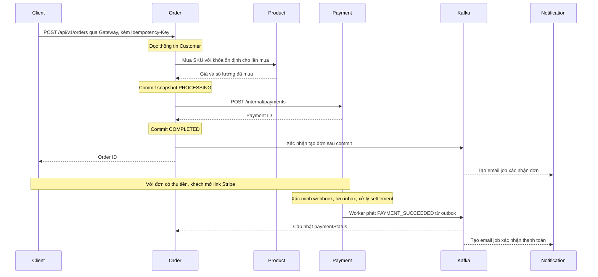
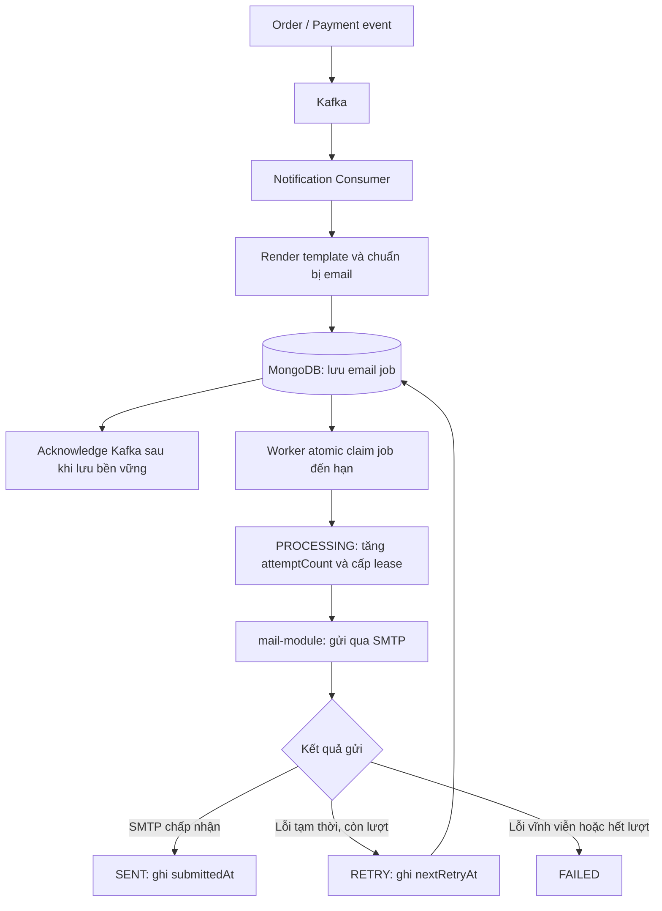

# Từ đặt hàng đến email xác nhận

Có hai sự kiện độc lập. Order phát xác nhận tạo đơn sau khi commit trạng thái `COMPLETED`. Payment phát `PAYMENT_SUCCEEDED` khi đã ghi nhận thanh toán thành công. Notification nhận mỗi sự kiện để tạo email job tương ứng.

## 1. Luồng tạo đơn hàng

### Khi một bước lỗi

- **Client mất response.** Gửi lại cùng request và `Idempotency-Key`. Order có thể tiếp tục từ snapshot đã lưu và dùng lại khóa của thao tác downstream. Product trừ kho trong transaction riêng. Hệ thống hiện chưa tự hoàn kho khi bước sau lỗi. [Thiết kế idempotency](checkout-idempotency-design.md)
- **Đơn đã tạo, khách chưa trả tiền.** Client đọc `GET /api/v1/orders/{id}/payment` để lấy link và trạng thái. Với đơn 0 VND, Payment ghi nhận thành công ngay và phát sự kiện qua cùng outbox. [Checkout Stripe](stripe-sandbox-design.md)
- **Kafka gián đoạn.** Payment lưu settlement và outbox trong cùng transaction để worker có thể gửi lại. Xác nhận tạo đơn của Order được gửi sau commit và chưa có outbox riêng. Vì vậy có thể thấy đơn đã tạo nhưng thiếu sự kiện email xác nhận đơn.

## 2. Luồng gửi email bất đồng bộ

Order và Payment phát sự kiện qua Kafka. Notification nhận sự kiện, chuẩn bị nội
dung email và lưu job; worker trong Notification thực hiện gửi SMTP sau đó.

Nếu chưa thấy email, tra job theo `eventId`. MongoDB lỗi có thể khiến consumer chưa acknowledge Kafka; job đã lưu có thể đang chờ worker thử lại. Nếu SMTP đã nhận email nhưng worker mất lease trước khi lưu kết quả, lần gửi sau có thể tạo email trùng. [Trạng thái job và retry](../services/notification/notification-delivery.md#stored-state-and-retry-policy)

## 3. Code và tài liệu liên quan

- [OrderService](../services/order/src/main/java/com/duong/ecommerce/order/service/OrderService.java)
- [PaymentService](../services/payment/src/main/java/com/duong/ecommerce/payment/service/PaymentService.java)
- [NotificationConsumer](../services/notification/src/main/java/com/duong/ecommerce/notification/integration/kafka/consumer/NotificationConsumer.java)
- [EmailJobStore](../services/notification/src/main/java/com/duong/ecommerce/notification/repository/EmailJobStore.java)
- [EmailDeliveryWorker](../services/notification/src/main/java/com/duong/ecommerce/notification/service/EmailDeliveryWorker.java)
- [Chi tiết thiết kế, cấu hình và theo dõi email job](../services/notification/notification-delivery.md)
- [Thiết kế mail-module](../support/mail-module/mail-module-design.md)
- [Quy tắc kiến trúc và ranh giới module](architecture-rules.md)
