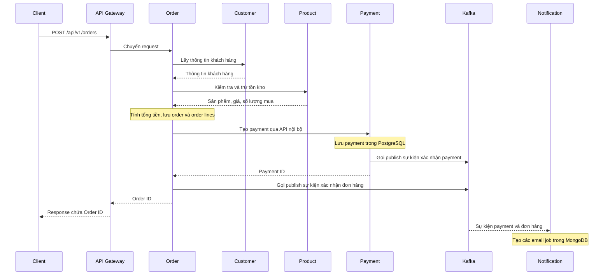
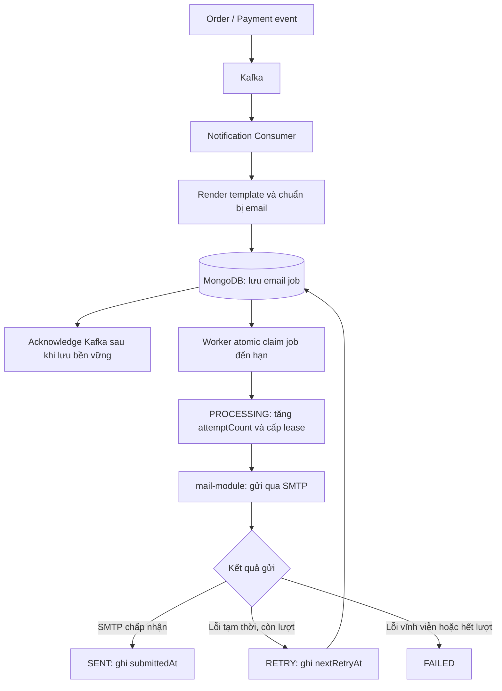

# Luồng tạo đơn hàng và gửi email bất đồng bộ

Tài liệu mô tả hành vi đang triển khai trong code, cập nhật ngày 2026-11-16.
Các bước thu tiền qua nhà cung cấp, Saga và Outbox chưa được triển khai.

## 1. Luồng tạo đơn hàng

Client gửi `POST /api/v1/orders` qua API Gateway. Order điều phối các lời gọi
HTTP đến Customer, Product và Payment trước khi trả kết quả cho client.

Các mũi tên publish thể hiện lời gọi gửi sự kiện. Producer trả về
`CompletableFuture`; luồng nghiệp vụ hiện không chờ future hoàn tất để xác nhận
Kafka đã nhận thành công. Notification xử lý độc lập, có thể nhận sự kiện trước
hoặc sau khi client nhận response; không bảo đảm thứ tự giữa hai topic.

### Các bước xử lý

1. **Customer:** Order lấy thông tin khách hàng theo `customerId`; không tìm thấy
   khách hàng thì dừng tạo đơn.
2. **Product:** kiểm tra sản phẩm, số lượng và tồn kho; khóa các bản ghi sản phẩm
   khi cập nhật, trừ tồn kho trong transaction của Product rồi trả dữ liệu mua hàng.
3. **Order:** tính tổng tiền từ giá và số lượng Product trả về, sau đó lưu order
   cùng các order lines trong PostgreSQL của Order.
4. **Payment:** Order gọi API nội bộ để tạo payment với `orderId`, tổng tiền,
   phương thức thanh toán và thông tin khách hàng. Payment lưu bản ghi rồi gọi
   publish sự kiện xác nhận payment.
5. **Order:** gọi publish sự kiện xác nhận đơn hàng, hoàn tất transaction cục bộ
   khi thành công và trả `orderId` cho client.

**Order đang tự tạo payment trong quá trình tạo đơn.** Với flow này, client không
cần gọi thêm `POST /internal/payments` cho cùng đơn hàng. Payment có ràng buộc unique
trên `order_id`; gửi thêm một yêu cầu tạo payment cho đơn đã có payment sẽ vi phạm
ràng buộc này.

Payment hiện chỉ lưu dữ liệu và phát sự kiện. Chọn `PAYPAL` trong request chưa
đồng nghĩa hệ thống đã gọi PayPal hoặc thu tiền thực tế. Email xác nhận payment
hiện được kích hoạt theo hành vi lưu bản ghi này.

### Ranh giới transaction và giới hạn hiện tại

- `@Transactional` ở Order chỉ bao phủ database của Order; không bao phủ database
  của Product, Payment hay Kafka.
- Nếu Product đã trừ kho nhưng bước sau lỗi, rollback của Order không tự hoàn kho.
  Payment cũng có thể đã lưu trong khi transaction của Order thất bại.
- Chưa có Saga để bù trừ và chưa có Outbox để bảo đảm dữ liệu database cùng sự kiện
  được ghi nhận nhất quán. Sự kiện có thể được xử lý trước khi Order commit.
- Trong trường hợp bình thường, hai loại sự kiện tạo hai email job riêng: xác nhận
  đơn hàng và xác nhận payment. Chúng có `eventId` riêng.

## 2. Luồng gửi email bất đồng bộ

Order và Payment phát sự kiện qua Kafka. Notification nhận sự kiện, chuẩn bị nội
dung email và lưu job; worker trong Notification thực hiện gửi SMTP sau đó.

### Consumer: nhận sự kiện và lưu job

1. Đọc sự kiện xác nhận đơn hàng hoặc payment từ Kafka.
2. Chọn template và render nội dung trong Notification. Lưu sẵn người gửi,
   người nhận, tiêu đề và nội dung vào job để các lần retry dùng cùng nội dung.
3. Lưu job vào MongoDB với trạng thái `PENDING`. `eventId` được dùng làm `_id`
   duy nhất để tránh tạo job trùng khi Kafka giao lại cùng sự kiện.
4. Chỉ acknowledge Kafka sau khi MongoDB xác nhận ghi bền vững, hoặc xác nhận job
   cùng ID đã tồn tại. Consumer không gọi SMTP trực tiếp.

Nếu chuẩn bị nội dung lỗi, consumer lưu job `FAILED` với mã
`MESSAGE_PREPARATION_FAILED` rồi acknowledge. Nếu MongoDB lỗi, offset chưa được
acknowledge và Kafka ingestion được thử lại. Hiện không có retry topic hoặc DLT;
bản ghi không xử lý được có thể chặn partition cho đến khi được giải quyết.

### Worker: gửi và retry

Worker nằm trong tiến trình Notification, mặc định kiểm tra job mỗi 5 giây và xử
lý tuần tự tối đa 20 job mỗi vòng. MongoDB atomic claim chọn job đến hạn và chuyển
sang `PROCESSING`, tăng `attemptCount`, cấp lease mặc định 2 phút và token riêng.
Các instance Notification phối hợp qua cơ chế này.

| Trạng thái | Ý nghĩa |
| --- | --- |
| `PENDING` | Đã lưu, chờ lần xử lý đầu tiên |
| `PROCESSING` | Worker đã claim, đang giữ lease |
| `RETRY` | Lỗi tạm thời, chờ đến `nextRetryAt` |
| `SENT` | SMTP đã chấp nhận gửi, có `submittedAt` |
| `FAILED` | Lỗi vĩnh viễn, lỗi chuẩn bị nội dung hoặc hết số lượt |

- Tối đa **5 lượt tổng cộng**, tính cả lượt đầu; thời gian chờ sau các lượt lỗi
  1–4 lần lượt là **1 phút / 5 phút / 15 phút / 1 giờ**, có jitter ±20%.
- Lỗi SMTP 4xx và lỗi kết nối/I/O tạm thời được retry. SMTP 5xx, lỗi xác thực,
  địa chỉ/nội dung không hợp lệ, TLS handshake và lỗi chưa phân loại được sẽ dừng.
- Job `PROCESSING` hết lease được phục hồi bằng claim mới nếu còn lượt; hết lượt
  thì chuyển `FAILED`. Claim đã tăng bộ đếm nên crash trước khi gọi SMTP vẫn có
  thể tiêu hao một lượt.
- Cập nhật kết quả phải khớp lease token để worker cũ không ghi đè kết quả của
  worker đã claim lại. Worker hiện chưa gia hạn lease khi đang gửi.

**`SENT` có nghĩa SMTP chấp nhận submission, tương ứng `SUBMITTED`; chưa chứng
minh email đã đến hộp thư hoặc đã được đọc.** Chưa theo dõi `DELIVERED/BOUNCED`.

SMTP và MongoDB không nằm trong cùng transaction. Nếu SMTP đã nhận mail nhưng
timeout, tiến trình crash hoặc không lưu được `SENT`, worker có thể gửi lại sau
khi lease hết hạn. Unique `eventId` ngăn tạo job trùng, không bảo đảm email được
gửi đúng một lần. Cơ chế hiện tại chấp nhận khả năng gửi mail trùng.

### Phân chia trách nhiệm

- **Order / Payment:** sở hữu nghiệp vụ và phát sự kiện.
- **Notification:** sở hữu template, render, lưu job, trạng thái, retry và lease.
- **mail-module:** thư viện gửi SMTP đồng bộ một lần; không lưu job hoặc quyết
  định retry. Module chạy trong Notification, không phải service riêng.

## 3. Code và tài liệu liên quan

- [OrderService](../services/order/src/main/java/com/duong/ecommerce/order/service/OrderService.java)
- [PaymentService](../services/payment/src/main/java/com/duong/ecommerce/payment/service/PaymentService.java)
- [NotificationConsumer](../services/notification/src/main/java/com/duong/ecommerce/notification/integration/kafka/consumer/NotificationConsumer.java)
- [EmailJobStore](../services/notification/src/main/java/com/duong/ecommerce/notification/repository/EmailJobStore.java)
- [EmailDeliveryWorker](../services/notification/src/main/java/com/duong/ecommerce/notification/service/EmailDeliveryWorker.java)
- [Chi tiết thiết kế, cấu hình và theo dõi email job](notification-delivery.md)
- [Thiết kế mail-module](mail-module-design.md)
- [Quy tắc kiến trúc và ranh giới module](architecture-rules.md)
