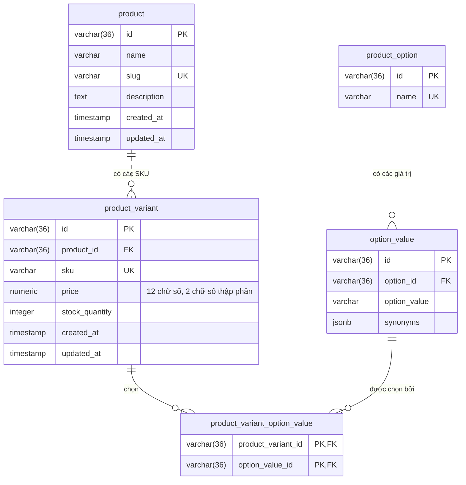
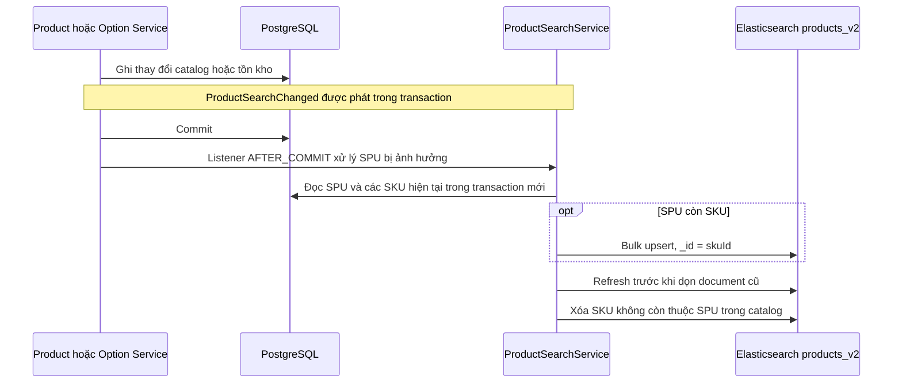

# Tìm kiếm sản phẩm SPU/SKU với Elasticsearch

Người mua có thể gõ “Điện thoại Nova N1”, “nova n1”, “N1 Nova”, hoặc gõ nhầm
“Nvoa N1” mà vẫn muốn tìm thấy cùng một sản phẩm. Nếu chọn thêm “Đen, 512GB,
còn hàng”, thẻ sản phẩm phải đại diện cho một biến thể thỏa cả ba điều kiện.

Product giải quyết bằng **một document Elasticsearch cho mỗi SKU**. Search
tìm theo tên và mô tả SPU hoặc mã SKU, lọc trên từng SKU rồi trả một SKU đại
diện cho mỗi SPU. PostgreSQL giữ dữ liệu gốc để kiểm tra giá và tồn kho lúc mua.
Xem [thiết kế catalog](product-catalog-design.md) và
[thiết kế search](product-search-design.md).

## 1. Request mẫu và kết quả mong đợi

Các ví dụ dùng `GET /api/v1/products/search` và dữ liệu mẫu đã đồng bộ. Bảng
mô tả kết quả cần thấy đối với Nova N1. Một số từ khóa cũng có thể khớp sản
phẩm khác trong catalog.

| Tham số request | Kỳ vọng từ phía người mua | Cách Elasticsearch xử lý |
| --- | --- | --- |
| `q=Điện thoại Nova N1` | Tìm thấy Nova N1 theo tên đầy đủ | Hiện có. `multi_match` tìm theo các token trong tên hoặc mô tả. Tên được tăng trọng số. [Elastic: multi-match](https://www.elastic.co/guide/en/elasticsearch/reference/8.13/query-dsl-multi-match-query.html) |
| `q=NOVA N1`, `q=nova n1` hoặc `q=N1 Nova` | Vẫn tìm thấy Nova N1 khi đổi hoa thường, bỏ bớt từ hoặc đảo thứ tự | Hiện có. Analyzer chuẩn chuyển token về chữ thường và `multi_match` với `AND` yêu cầu đủ token truy vấn trong cùng một trường, theo bất kỳ thứ tự nào. [Elastic: standard analyzer](https://www.elastic.co/guide/en/elasticsearch/reference/8.13/analysis-standard-analyzer.html) |
| `q=Nvoa N1` | Vẫn tìm thấy Nova N1 khi đảo nhầm hai ký tự trong “Nova” | Hiện có cơ chế `fuzziness: AUTO` và fuzzy transpositions mặc định. Ca này dùng để kiểm thử lỗi gõ. Kết quả còn tùy độ dài token và mức độ sai. [Elastic: match query](https://www.elastic.co/guide/en/elasticsearch/reference/8.13/query-dsl-match-query.html) |
| `q=demo-phone-01-03` | Tìm đúng biến thể Nova N1 Đen/512GB theo mã | Hiện có. `term` trên trường `keyword` khớp toàn bộ mã, bỏ qua hoa thường ASCII. [Elastic: term query](https://www.elastic.co/guide/en/elasticsearch/reference/8.13/query-dsl-term-query.html) |
| `q=Nova N1` + Màu sắc=Đen + Dung lượng=512GB + `hasStock=true` | Thấy Nova N1 đại diện bởi `DEMO-PHONE-01-03` khi SKU này còn hàng. Với 256GB, Nova N1 biến mất vì thiếu biến thể Đen/256GB | Hiện có. Mỗi cặp option khớp trong cùng phần tử `attrs`. Tất cả điều kiện áp lên cùng document SKU rồi mới `collapse` theo `spuId`. [Elastic: nested query](https://www.elastic.co/guide/en/elasticsearch/reference/8.13/query-dsl-nested-query.html) |
| `q=dien thoai Nova N1` | Tìm thấy Nova N1 bằng tên tiếng Việt không dấu | Mong muốn. Đề xuất thêm trường tìm kiếm chuẩn hóa dấu bằng `lowercase` và `asciifolding`, đồng thời giữ trường gốc để xếp hạng theo tên có dấu. Index hiện tại chưa cấu hình chuẩn hóa dấu. [Elastic: ASCII folding](https://www.elastic.co/docs/reference/text-analysis/analysis-asciifolding-tokenfilter) |
| `q=Điện thoại No` | Gợi ý Nova N1 khi người mua đang gõ dở | Mong muốn. Nếu cần autocomplete, đề xuất trường `search_as_you_type` với truy vấn `bool_prefix`. Kiểu gõ này chưa có nhánh truy vấn riêng. [Elastic: search-as-you-type](https://www.elastic.co/guide/en/elasticsearch/reference/8.13/search-as-you-type.html) |

Khi kiểm tra các cách gõ, dùng `spuId` để xác nhận kết quả cùng trỏ tới Nova
N1. Với mã SKU hoặc lọc thuộc tính, kiểm tra cả `skuId` hoặc `sku` để xác nhận
đúng biến thể. Thuộc tính như màu và dung lượng được gửi qua `options[]`.
Ví dụ `q=Nova N1 đen 512GB` hiện được xử lý như từ khóa văn bản thông thường.

## 2. Xây catalog theo SPU và SKU

**SPU** là mẫu sản phẩm, chẳng hạn “Điện thoại Nova N1”. SPU giữ tên, slug và mô tả
dùng chung. **SKU** là biến thể cụ thể có thể mua, chẳng hạn “Nova N1, Đen, 512GB,
RAM 12GB”. SKU có UUID (`skuId`), mã riêng (`sku`), giá và tồn kho riêng.

### Sơ đồ bảng PostgreSQL



- Bốn bảng có cột `id` dùng UUID lưu dưới dạng `varchar(36)`. Bảng nối có khóa
  chính ghép `(product_variant_id, option_value_id)`. Giá trị option duy nhất
  trong phạm vi `(option_id, option_value)`.
- `product_option` định nghĩa thuộc tính như “Màu sắc”; `option_value` lưu giá trị
  như “Đen”. Bảng nối cho biết từng SKU chọn giá trị nào. Khi tạo SKU, Product
  kiểm tra mỗi option chỉ được chọn một giá trị và tổ hợp không trùng trong SPU.
- SPU có thể chưa có SKU; lúc đó trang chi tiết vẫn có thể đọc từ catalog nhưng
  SPU không xuất hiện trong search. Xóa option hoặc giá trị sẽ xóa các liên kết
  trong bảng nối; các SKU liên quan vẫn tồn tại với ít thuộc tính hơn.

Để tạo catalog qua API, tạo option, thêm các giá trị rồi gửi `POST /api/v1/products`
với danh sách `variants`, mỗi biến thể tham chiếu các UUID qua `optionValueIds`.
Xem [payload tạo Product](product-catalog-design.md#api-usage) hoặc nạp catalog
mẫu bằng [script import](../scripts/README.md#nạp-qua-api). Schema đầy đủ nằm trong
[migration Flyway](../services/product/src/main/resources/db/migration/V1__init_catalog_schema.sql).

## 3. Cấu hình Elasticsearch ở local

Từ thư mục gốc repo, khi hạ tầng cơ bản (PostgreSQL, Keycloak…) đã chạy:

```sh
docker compose --profile search up -d elasticsearch
curl -fsS 'http://localhost:9200/_cluster/health?wait_for_status=yellow&timeout=30s'
```

[docker-compose.yml](../docker-compose.yml) chạy Elasticsearch **8.13.4** ở chế độ
single node, dùng heap 512 MB và volume `elasticsearch`. Port `9200` chỉ bind vào
`127.0.0.1`; xác thực Elasticsearch được tắt cho cấu hình local này.

Khởi động Config Server, Discovery và Product theo
[hướng dẫn chạy local](../README.vi.md#chạy-các-service-ở-local). Product chạy trên
port `8050` và lấy cấu hình từ
[`product-service.yml`](../cloud/config-server/src/main/resources/configurations/product-service.yml):

| Thuộc tính Spring | Biến cấu hình | Mặc định |
| --- | --- | --- |
| `spring.elasticsearch.uris` | `ELASTICSEARCH_URIS` | `http://localhost:9200` |
| `spring.elasticsearch.username` | `ELASTICSEARCH_USERNAME` | Rỗng |
| `spring.elasticsearch.password` | `ELASTICSEARCH_PASSWORD` | Rỗng |
| `spring.elasticsearch.connection-timeout` | | `2s` |
| `spring.elasticsearch.socket-timeout` | | `5s` |

Nếu trỏ tới cluster có bảo mật, cấu hình URI HTTPS, thông tin xác thực và chứng
chỉ tin cậy phù hợp. Xác thực kết nối Elasticsearch và JWT gọi API Product là
hai cấu hình riêng. Product dùng Spring Data `ElasticsearchOperations` trực tiếp;
Elasticsearch repositories được tắt.

## 4. Từ bảng catalog đến index `products_v2`

[`ProductMapper`](../services/product/src/main/java/com/duong/ecommerce/product/mapper/ProductMapper.java)
kết hợp dữ liệu từ SPU, SKU và các giá trị option mà SKU đó chọn. Tên/mô tả SPU
được lặp trong các document SKU để Elasticsearch tìm theo nội dung sản phẩm và
lọc biến thể trong cùng truy vấn.

| Trường trong document | Nguồn | Mapping Elasticsearch |
| --- | --- | --- |
| `skuId` | `product_variant.id`; đồng thời là document `_id` | `keyword` |
| `spuId` | `product.id`; khóa gộp kết quả | `keyword` |
| `sku`, `slug` | Mã SKU, slug của SPU | `keyword` |
| `skuTitle`, `description` | Tên, mô tả của SPU | `text` |
| `skuPrice` | Giá của SKU | `scaled_float`, hệ số 100 |
| `stockQuantity`, `hasStock` | Số lượng SKU và biểu thức `stockQuantity > 0` | `integer`, `boolean` |
| `attrs` | Các giá trị option của SKU | `nested`; `attrId`, `attrName`, `attrValueId`, `attrValue` đều là `keyword` |

Mapping lấy từ
[`SkuSearchDocument`](../services/product/src/main/java/com/duong/ecommerce/product/integration/search/SkuSearchDocument.java)
và [`SkuAttributeDocument`](../services/product/src/main/java/com/duong/ecommerce/product/integration/search/SkuAttributeDocument.java).
Product tạo index cùng mapping khi lần đầu search, đồng bộ hoặc reindex mà index
chưa tồn tại. Việc tạo index không tự nạp SKU có sẵn trong PostgreSQL.

### Đồng bộ sau commit



Luồng này chạy khi tạo/xóa SPU, thêm/xóa SKU, mua hàng làm thay đổi tồn kho, hoặc
xóa option/giá trị có SKU đang dùng. Nếu SPU bị xóa hoặc không còn SKU, service
xóa toàn bộ document có `spuId` đó. Ghi lại cùng `skuId` cập nhật đúng document.
Nếu transaction nghiệp vụ rollback, listener không chạy cho thay đổi đó.

Listener chạy đồng bộ sau commit nên request ghi có thể chờ Elasticsearch.
Lỗi đồng bộ được ghi log; transaction PostgreSQL đã commit vẫn giữ kết quả.
Không có retry bền vững. Nếu index thiếu hoặc cũ sau lỗi, hoặc nếu nạp bằng SQL
trực tiếp (không phát event), dùng reindex để dựng lại.

### Reindex và kiểm tra mapping

Tạm dừng ghi catalog và mua hàng, chờ các request ghi hoàn tất, rồi chạy một
lần reindex với JWT hợp lệ đã đặt trong `PRODUCT_API_TOKEN`:

```sh
curl -fsS -X POST 'http://localhost:8050/api/v1/products/search/reindex' \
  -H "Authorization: Bearer ${PRODUCT_API_TOKEN}"

curl -fsS 'http://localhost:9200/products_v2/_mapping?pretty'
curl -fsS 'http://localhost:9200/products_v2/_count?pretty'
```

Reindex xóa document trong **index đang phục vụ**, đọc catalog theo lô 200 SPU,
ghi các SKU rồi refresh. Phản hồi `data` là số **SKU** đã index; `_count` cũng đếm
document SKU. Search có thể trả thiếu trong lúc rebuild. Nếu rebuild lỗi, sửa
nguyên nhân và chạy lại. Reindex giữ mapping hiện có và không đụng tới index
`products` cũ. Đổi mapping không tương thích cần kế hoạch migration riêng.

## 5. Logic tìm kiếm theo SPU và SKU

[`ProductSearchService`](../services/product/src/main/java/com/duong/ecommerce/product/service/ProductSearchService.java)
thực hiện theo thứ tự:

1. **Khớp nội dung SPU hoặc mã SKU.** Nếu `q` rỗng hoặc chỉ có khoảng trắng,
   dùng `match_all`. Với `q` có nội dung, yêu cầu ít nhất một nhánh khớp:
   - `multi_match` trên `skuTitle^3` và `description`, với `operator: AND` và
     `fuzziness: AUTO`. Với mặc định `best_fields`, các token phải khớp trong
     cùng một trường. Xem [multi-match trong Elasticsearch](https://www.elastic.co/guide/en/elasticsearch/reference/8.13/query-dsl-multi-match-query.html).
   - `term` trên `sku`, khớp toàn bộ mã, không phân biệt hoa thường ASCII, với
     `boost: 5`. Điểm boost ưu tiên mã khớp; API không tìm chuỗi con của mã.
2. **Lọc trên từng SKU.** Mỗi cặp `options[i].name` và `options[i].value` tạo một
   [truy vấn `nested`](https://www.elastic.co/guide/en/elasticsearch/reference/8.13/query-dsl-nested-query.html)
   buộc tên và giá trị nằm trong cùng một phần tử `attrs`. Các cặp lọc được nối
   bằng AND ở document SKU. Tên và giá trị phân biệt hoa thường và dấu.
   `hasStock=true` chỉ lấy SKU còn hàng, `false` chỉ lấy SKU hết hàng, bỏ qua
   tham số thì lấy cả hai.
3. **Gộp các SKU khớp theo SPU.** Elasticsearch
   [`collapse` theo `spuId`](https://www.elastic.co/guide/en/elasticsearch/reference/8.13/collapse-search-results.html)
   lấy SKU đứng đầu mỗi nhóm theo `_score DESC, spuId ASC, skuId ASC`. SKU đại diện
   không nhất thiết rẻ nhất hoặc có nhiều hàng nhất. Dùng `spuId` để mở trang chi
   tiết và `skuId` để tham chiếu biến thể.
4. **Đếm SPU cho phân trang.** `hits.total` của Elasticsearch tính theo SKU trước
   khi gộp. API tính `data.page_info.total_elements` theo SPU bằng
   [composite aggregation](https://www.elastic.co/guide/en/elasticsearch/reference/8.13/search-aggregations-bucket-composite-aggregation.html):
   dùng cùng bộ điều kiện, đếm các bucket `spuId` theo lô 500 và tiếp tục bằng
   `after_key`. Việc đếm tăng theo số SPU khớp; các request không dùng chung
   snapshot nên kết quả có thể thay đổi nếu index được cập nhật trong lúc đếm.

API nhận `page` từ 1 (mặc định 1), `size` từ 1 đến 100 (mặc định 20), và yêu cầu
`page * size <= 10000`. `q` tối đa 200 ký tự; tối đa 20 cặp option, mỗi tên và
giá trị không được để trống và tối đa 100 ký tự. Hiện chưa cấu hình autocomplete,
chuẩn hóa dấu tiếng Việt hoặc đồng nghĩa cho search; `option_value.synonyms`
không tham gia truy vấn.

### Thử với catalog mẫu

Sau khi nạp dữ liệu, chạy lần lượt các request theo tên và mã SKU. Trong mỗi
phản hồi, tìm kết quả có `slug=demo-dien-thoai-nova-n1` rồi so sánh `spuId`.
Request cuối cần trả đúng mã `DEMO-PHONE-01-03` cho Nova N1.
[Hướng dẫn nạp dữ liệu mẫu](../scripts/README.md#nạp-qua-api)

```sh
for query in 'Điện thoại Nova N1' 'NOVA N1' 'N1 Nova' 'Nvoa N1' 'demo-phone-01-03'
do
  printf '\nq=%s\n' "$query"
  curl -fsS --get 'http://localhost:8050/api/v1/products/search' \
    --data-urlencode "q=$query"
  printf '\n'
done
```

Trong catalog mẫu, Nova N1 có SKU **Đen/512GB** (`DEMO-PHONE-01-03`) và
**Trắng/256GB** (`DEMO-PHONE-01-06`). Dùng request sau để kiểm tra bộ lọc trên
cùng một SKU.

```sh
curl -fsS --get 'http://localhost:8050/api/v1/products/search' \
  --data-urlencode 'q=Nova N1' \
  --data-urlencode 'options[0].name=Màu sắc' \
  --data-urlencode 'options[0].value=Đen' \
  --data-urlencode 'options[1].name=Dung lượng' \
  --data-urlencode 'options[1].value=512GB' \
  --data-urlencode 'hasStock=true'
```

- `data.content` có một kết quả của Nova N1, đại diện bởi `DEMO-PHONE-01-03` khi
  SKU đó còn hàng. Đổi `512GB` thành `256GB` thì Nova N1 không xuất hiện.
- Để thử qua Gateway, dùng URL public
  `http://localhost:8222/api/public/v1/products/search`. Endpoint trực tiếp và
  route public đều cho phép GET không cần JWT.

Nếu mới nạp đủ dữ liệu mẫu vào catalog trống và đã đồng bộ, bỏ `q` cùng các bộ lọc
sẽ cho `total_elements = 50` SPU, trong khi `products_v2/_count` trả 323 SKU.
Xem [test tích hợp Elasticsearch](../services/product/src/test/java/com/duong/ecommerce/product/integration/ProductSearchIntegrationTest.java)
để kiểm tra lọc cùng SKU, collapse, stock và reindex.

## 6. Vấn đề tồn đọng và hành vi chấp nhận

| Tình huống | Dữ liệu search thay đổi khi nào? | Hành vi người dùng có thể thấy |
| --- | --- | --- |
| Tạo SPU kèm SKU hoặc thêm SKU | Sau khi PostgreSQL commit, listener ghi SKU vào `products_v2` và gọi refresh. Upsert đã thành công sẽ thấy được sau bước refresh thành công. | Search chạy song song có thể chưa thấy sản phẩm hoặc biến thể mới. SPU tạo chưa có SKU sẽ xuất hiện trên search sau khi có SKU được index. |
| Sửa tên, mô tả, giá hoặc tồn kho thủ công | Catalog hiện chưa có API sửa trực tiếp các trường này. Sửa bằng SQL bỏ qua event và cần reindex. API sửa trong tương lai cần phát event cho SPU bị ảnh hưởng rồi đồng bộ các SKU. | Search có thể tiếp tục hiển thị thông tin cũ cho tới khi index được cập nhật. |
| Xóa SPU hoặc SKU | Listener có xử lý xóa sau commit. Xóa SPU dọn mọi document theo `spuId`. Xóa một SKU dọn document của SKU đó. Code refresh trước khi dọn. Search thấy kết quả xóa sau lần refresh tiếp theo. | Trong khoảng chờ, search vẫn có thể trả về thẻ cũ. Khi mở chi tiết một SPU đã xóa, Product đọc PostgreSQL và trả lỗi không tìm thấy. |
| Mua SKU còn đúng một đơn vị | PostgreSQL giảm tồn từ 1 xuống 0 khi giao dịch mua commit. Listener ghi lại cùng `skuId` với `stockQuantity=0`, `hasStock=false` rồi refresh. | Người đến sau có thể tạm thấy “còn hàng”. Sau refresh, `hasStock=true` loại SKU hết hàng và SPU chỉ còn xuất hiện nếu có SKU khác thỏa truy vấn. Khi bỏ lọc tồn kho, SKU hết hàng vẫn có thể xuất hiện. |

**Với SKU cuối**, chấp nhận kết quả search có thể hiển thị tồn kho cũ trong lúc
đồng bộ. Search cũng có thể đã tải kết quả trước khi người khác mua. Khi người
thứ hai mua cùng SKU, Product khóa dòng SKU và kiểm tra tồn trong PostgreSQL.
Nếu tồn đã về 0, Product từ chối giao dịch do hết hàng. [Luồng mua trong ProductService](../services/product/src/main/java/com/duong/ecommerce/product/service/ProductService.java)

**Độ trễ hiện tại chưa có số đo và chưa có SLA.** Listener chạy đồng bộ sau
commit, nên thời gian hiển thị phụ thuộc vào bước đọc PostgreSQL, ghi Elasticsearch
và refresh. Với xóa, còn có thời gian thực thi `delete_by_query` và chờ refresh
sau đó. Elasticsearch có chu kỳ refresh mặc định khoảng một giây cho index đang
được tìm kiếm. Thời gian từ commit đến search còn gồm các bước trên.
Timeout kết nối 2 giây và timeout socket 5 giây cũng là các cấu hình riêng.
[Elastic: near real-time search](https://www.elastic.co/guide/en/elasticsearch/reference/8.13/near-real-time.html) và [Elastic: delete by query](https://www.elastic.co/guide/en/elasticsearch/reference/8.13/docs-delete-by-query.html)

Để đo, chạy search lặp từ trước khi gửi request ghi trên môi trường thử nghiệm.
Đo từ lúc PostgreSQL commit đến lần đầu search thấy SKU mới, thấy tồn kho mới
hoặc thấy SKU đã biến mất. Nếu chỉ đo được từ lúc gửi request ghi, ghi rõ đó
là thời gian từ phía client. Ghi cả khoảng cách giữa các lần gọi search để biết
độ phân giải của phép đo, rồi tổng hợp p50/p95 theo từng thao tác. Dùng luồng
search bình thường trong phép đo để quan sát được thời gian chờ refresh tự nhiên.

**Nếu đồng bộ lỗi**, PostgreSQL vẫn giữ thay đổi đã commit. Index có thể thiếu
hoặc giữ dữ liệu cũ tới lần đồng bộ thành công của SPU đó hoặc khi vận hành chạy
reindex. Các lần đồng bộ chạy chồng nhau cũng có thể để lại dữ liệu cũ. Hiện
chưa có cơ chế retry bền vững hay đối soát tự động. Tìm log
`SKU search synchronization failed` và làm theo [hướng dẫn reindex](#reindex-và-kiểm-tra-mapping).

**Chất lượng từ khóa còn cần kiểm chứng.** Chuẩn hóa dấu tiếng Việt và gợi ý
khi gõ là phương án đề xuất. Trước khi chốt thay đổi mapping, dùng các request
ở đầu tài liệu để đối chiếu cả sản phẩm xuất hiện và vị trí của nó khi catalog
có nhiều model tên gần nhau như Nova N1 và Nova N2.
